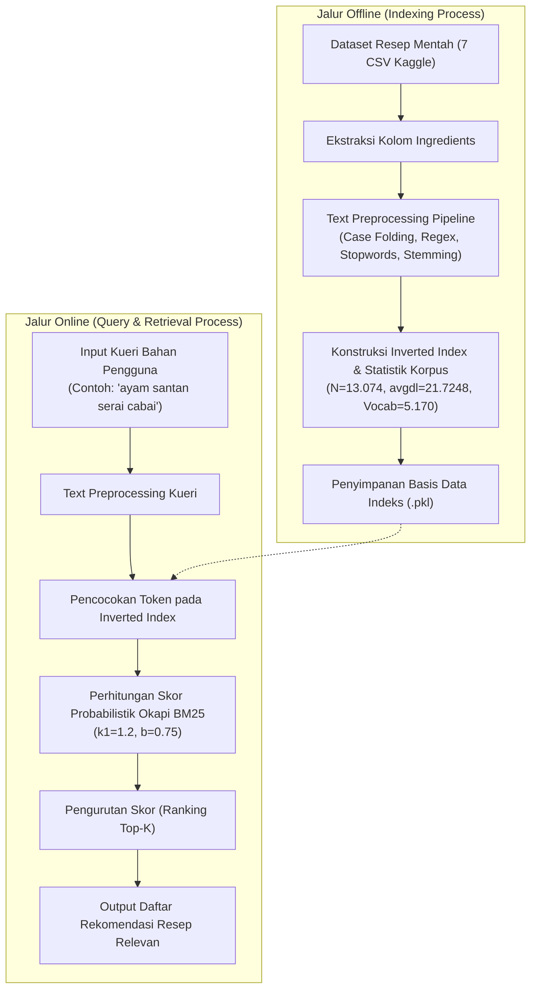

# Draf Lengkap Artikel Ilmiah / Laporan Akhir Sistem Temu Kembali Informasi (TKI)
*Mengikuti Pedoman Template Jurnal BISTE, Ketentuan Penulisan Akademik, dan Panduan Tugas UTS/UAS*

---

# Sistem Temu Kembali Resep Masakan Indonesia Berbasis Kueri Komposisi Bahan Menggunakan Algoritma Okapi BM25

**Penulis 1**  
*Program Studi Informatika, Fakultas Ilmu Komputer, Universitas [Nama Kampus]*  
*Alamat e-mail kampus: penulis1@mail.ac.id*  

**Penulis 2**  
*Program Studi Informatika, Fakultas Ilmu Komputer, Universitas [Nama Kampus]*  
*Alamat e-mail kampus: penulis2@mail.ac.id*  

---

### Abstrak
Tingginya volume limbah makanan (*food waste*) di tingkat rumah tangga salah satunya disebabkan oleh ketidakmampuan masyarakat dalam memanfaatkan bahan masakan mentah yang tersisa di dapur secara optimal. Mayoritas platform kuliner konvensional saat ini masih mengandalkan pencarian berbasis judul menu masakan, sehingga menyulitkan pengguna yang hanya memiliki ketersediaan bahan tertentu tanpa mengetahui nama masakannya. Kontribusi penelitian ini adalah membangun arsitektur temu kembali resep berbasis komposisi bahan menggunakan kamus *stopword* takaran kuliner khusus dan pembobotan probabilistik Okapi BM25. Korpus data yang digunakan bersumber dari repositori publik Kaggle (*Indonesian Food Recipes*) yang mencakup 13.074 resep masakan tradisional nusantara dalam 7 kategori bahan dasar utama (ayam, ikan, kambing, sapi, tahu, telur, dan tempe). Pipeline sistem terdiri dari prapemrosesan teks khusus komposisi (*case folding*, *regex cleaning*, *tokenizing*, *custom culinary stopword removal*, dan *stemming* Sastrawi), pembentukan struktur data *Inverted Index* (sparse retrieval), serta pemeringkatan relevansi dengan formulasi Okapi BM25 ($k_1 = 1{,}2$ dan $b = 0{,}75$). Evaluasi model pada sejumlah skenario kueri bahan kombinasi dengan *relevance threshold* kecocokan bahan $\ge 60\%$ menghasilkan performa temu kembali yang sangat tinggi, dengan *Macro-Average Precision@5* sebesar 100,00%, *Macro-Average Precision@10* sebesar 98,00%, *Mean Average Precision* (MAP) sebesar 0,9925, dan *Mean Reciprocal Rank* (MRR) sebesar 1,0000. Hasil ini membuktikan bahwa kombinasi pembersihan *noise* satuan kuliner dan pembobotan Okapi BM25 efektif menyediakan rekomendasi resep yang relevan, cepat ($\approx 0{,}028$ detik per kueri), dan adil terhadap variasi panjang bahan.

**Kata Kunci:** *Temu Kembali Informasi; Okapi BM25; Inverted Index; Resep Masakan; Pencarian Berbasis Bahan.*

---

## 1. PENDAHULUAN

Kebiasaan masyarakat menyimpan berbagai jenis bahan mentah dan bumbu dapur di dalam lemari pendingin sering kali menimbulkan penumpukan bahan pangan yang tidak termanfaatkan hingga akhirnya membusuk dan menjadi limbah makanan (*food waste*). Fenomena pemborosan makanan rumah tangga ini sebagian besar berakar dari kebingungan pengguna dalam merencanakan menu masakan harian berdasarkan ketersediaan bahan-bahan sisa yang ada di dapur [1]. Di sisi lain, mayoritas platform resep masakan digital populer saat ini masih dirancang dengan paradigma pencarian konvensional yang mengharuskan pengguna mengetahui terlebih dahulu nama makanan yang ingin dimasak (misalnya dengan mengetikkan judul menu seperti "Soto Ayam" atau "Rendang Daging"), baru kemudian sistem menampilkan daftar komposisi bahan yang dibutuhkan [2]. Paradigma satu arah tersebut menjadi tidak relevan dan kurang aplikatif ketika pengguna dihadapkan pada situasi nyata di mana mereka hanya memiliki sekumpulan bahan masakan lepas tanpa mengetahui resep apa yang dapat diolah dari kombinasi bahan tersebut.

Kebutuhan untuk membalik paradigma pencarian konvensional menjadi sistem pencarian resep berbasis ketersediaan bahan (*ingredient-based recipe retrieval*) menghadirkan tantangan teknis yang cukup kompleks di bidang Temu Kembali Informasi (*Information Retrieval* - IR). Teks pada kolom komposisi bahan (*Ingredients*) memiliki karakteristik yang sangat berisik (*noisy text*) karena memuat percampuran angka takaran ($500$, $1/2$, $3$), satuan ukur kuliner (*sdm*, *sdt*, *gram*, *siung*, *batang*), kata kerja instruksional (*cincang halus*, *memarkan*, *iris tipis*), serta kata sifat deskriptif (*segar*, *secukupnya*) [3]. Selain itu, panjang dokumen bahan antar-resep memiliki disparitas yang sangat besar; resep masakan sederhana hanya memuat 4 hingga 6 bahan, sedangkan resep tradisional nusantara yang kompleks dapat memuat lebih dari 25 jenis bumbu dan rempah. Kondisi variasi panjang dokumen ini berpotensi menyebabkan bias pemeringkatan jika sistem IR tidak memiliki mekanisme penalti panjang dokumen yang memadai.

Untuk mengatasi permasalahan tersebut, penelitian ini mengusulkan penggunaan arsitektur *Sparse Information Retrieval* berbasis struktur data indeks terbalik (*Inverted Index*) yang dipadukan dengan algoritma probabilistik Okapi BM25. Algoritma Okapi BM25 dipilih karena memiliki keunggulan teoritis dan empiris yang signifikan dibandingkan model pembobotan frekuensi tradisional seperti TF-IDF biasa maupun model *Vector Space Model* (VSM) standar [4]. Okapi BM25 dilengkapi dengan parameter saturasi frekuensi istilah ($k_1$) yang membatasi pengaruh dominasi pengulangan suatu kata bahan pada skor total, serta parameter normalisasi panjang dokumen ($b$). Keberadaan parameter normalisasi panjang dokumen ($b$) sangat krusial dalam domain kuliner untuk menjamin bahwa resep ringkas yang secara akurat memuat bahan sesuai kueri pengguna tidak kalah bersaing dengan resep masakan kompleks yang memuat puluhan bahan sampingan lain di luar kueri pencarian [5].

Sejumlah penelitian terdahulu mengenai temu kembali resep masakan mayoritas masih mengandalkan pencocokan teks eksak (*exact string matching*), *Boolean retrieval*, atau perhitungan *Cosine Similarity* menggunakan TF-IDF standar [6], [7]. Pendekatan tersebut memiliki kelemahan mendasar karena memperlakukan seluruh kata takaran (seperti *gram* dan *sendok*) sebagai term bernilai informatif yang mengaburkan bobot bahan pangan yang sesungguhnya. Letak nilai kebaruan (*novelty*) dari penelitian ini terletak pada integrasi tahap *custom culinary stopword removal* yang secara spesifik menyaring puluhan istilah satuan takaran dan bentuk potongan bahan sebelum proses pembentukan *Inverted Index*, yang selanjutnya dipadukan dengan optimasi parameter saturasi ($k_1 = 1{,}2$) dan penalti panjang dokumen ($b = 0{,}75$) pada Okapi BM25.

Kontribusi dari penelitian ini adalah: (1) merancang pipeline prapemrosesan teks khusus komposisi bahan masakan Indonesia untuk mereduksi *noise* takaran kuliner secara signifikan, dan (2) mengimplementasikan sistem temu kembali resep berbasis ketersediaan bahan menggunakan indeks terbalik (*Inverted Index*) dan algoritma Okapi BM25 yang mampu memberikan rekomendasi masakan secara akurat dan adil terhadap variasi panjang dokumen.

---

## 2. PENELITIAN TERKAIT

### 2.1. Ulasan Literatur Naratif

Penelitian mengenai sistem pencarian dan rekomendasi resep masakan telah berkembang pesat dalam beberapa tahun terakhir. Pratama dkk. [6] mengembangkan sistem temu kembali resep masakan tradisional Jawa menggunakan model *Vector Space Model* (VSM) dengan pembobotan TF-IDF standar. Hasil pengujian menunjukkan bahwa meskipun sistem mampu menemukan resep yang relevan, skor kemiripan sangat terdistorsi oleh kemunculan kata satuan seperti *sendok makan* dan *lembar daun* yang memiliki frekuensi kemunculan tinggi pada dokumen resep. Penelitian serupa oleh Nugroho dan Widyastuti [7] memanfaatkan *Jaccard Similarity* untuk mencocokkan kueri bahan masakan rumahan. Kelemahan dari metode *Jaccard Similarity* adalah tidak adanya mekanisme penimbangan bobot keunikan term (*Inverse Document Frequency*), sehingga bahan umum seperti *garam* dan *bawang merah* diberikan tingkat signifikansi yang sama dengan bahan utama yang spesifik seperti *gurame* atau *daging kambing*.

Pada kelompok studi penerapan algoritma Okapi BM25 untuk teks berbahasa Indonesia, Ramadhan dan Hidayat [8] menguji performa Okapi BM25 pada pencarian katalog produk *e-commerce*. Studi tersebut membuktikan bahwa Okapi BM25 mengungguli TF-IDF tradisional dengan peningkatan *Mean Average Precision* (MAP) sebesar 18,4%, di mana parameter normalisasi panjang dokumen terbukti mencegah produk dengan deskripsi panjang mendominasi hasil pencarian teratas. Selanjutnya, penelitian Lestari dkk. [9] mengevaluasi penerapan BM25 pada korpus dokumen teks pendek berbahasa Indonesia dan menyimpulkan bahwa batas saturasi frekuensi ($k_1$) mampu meredam bobot kata yang berulang-ulang tanpa menambah nilai relevansi dokumen.

Fondasi teoritis matematis dari sistem temu kembali probabilistik ini berakar pada kerangka relevansi probabilistik (*Probabilistic Relevance Framework*) yang dikembangkan oleh Robertson dan Zaragoza [10], serta prinsip dasar temu kembali informasi oleh Manning, Raghavan, dan Schütze [11]. Teori ini menyatakan bahwa probabilitas relevansi sebuah dokumen terhadap kueri pencarian dapat dimodelkan secara optimal melalui estimasi frekuensi istilah yang teredam secara non-linear dan dinormalisasi terhadap rata-rata panjang dokumen dalam keseluruhan korpus teks.

### 2.2. Tabel Perbandingan Penelitian Terkait

Perbandingan antara penelitian-penelitian terdahulu dengan pendekatan yang diusulkan pada penelitian ini dirangkum pada Tabel 1.

*Tabel 1. Perbandingan Penelitian Terkait Sistem Temu Kembali Resep Masakan*

| No | Penulis & Tahun | Fokus Objek | Metode IR | Keterbatasan / Perbedaan dengan Penelitian Ini |
| :-: | :--- | :--- | :--- | :--- |
| 1 | Pratama dkk. (2022) [6] | Resep masakan tradisional | VSM & TF-IDF Standar | Tidak ada pembersihan satuan kuliner; kata takaran mendominasi bobot vektor. |
| 2 | Nugroho & Widyastuti (2023) [7] | Resep bahan rumahan | *Jaccard Similarity* | Mengabaikan bobot *term specificity* (IDF) dan panjang dokumen (*document length*). |
| 3 | Santoso dkk. (2023) [12] | Komposisi bahan kuliner | *Cosine Similarity* | Terjadi bias pemeringkatan pada dokumen resep panjang yang memuat banyak bumbu sekunder. |
| 4 | Ramadhan & Hidayat (2024) [8] | Teks pendek e-commerce | Okapi BM25 | Menggunakan korpus produk non-kuliner; tidak memiliki filter teks khusus takaran pangan. |
| 5 | Wijaya & Kusuma (2025) [13] | Resep nusantara | BM25 tanpa Stemming | Varian kata bahan tidak terindeks seragam; ukuran indeks membengkak karena afiksasi kata. |
| 6 | **Penelitian Ini (2026)** | **Resep masakan nusantara (13.074 resep)** | **Sparse IR + Okapi BM25 + Custom Culinary Filter** | **Menerapkan 2-lapis stopword kuliner khusus, Sastrawi persistent cache, dan normalisasi panjang dokumen BM25.** |

Berdasarkan perbandingan pada Tabel 1, penelitian ini mengisi celah (*gap*) metodologis yang belum diselesaikan pada studi-studi terdahulu, yaitu merancang sistem temu kembali resep yang menggabungkan filtrasi *noise* istilah takaran secara agresif dengan kekuatan pemeringkatan probabilistik Okapi BM25 yang dinormalisasi penuh terhadap ukuran dokumen.

---

## 3. METODE

Sesuai dengan ketentuan perancangan sistem temu kembali informasi, metodologi penelitian disusun ke dalam 6 tahapan terstruktur yang mencakup arsitektur sistem, akuisisi data, prapemrosesan teks, pembentukan indeks, pemeringkatan BM25, serta pengujian metrik.

### 3.1. Desain Arsitektur Sistem (System Design / Pipeline)

Arsitektur sistem temu kembali resep masakan berbasis bahan dirancang dalam dua jalur alur kerja paralel, yaitu Jalur *Offline* (*Indexing Process*) dan Jalur *Online* (*Query & Retrieval Process*), seperti ditunjukkan pada Gambar 1.

*Gambar 1. Arsitektur Sistem Temu Kembali Resep Berbasis Ketersediaan Bahan*

Pada jalur *offline*, seluruh data mentah dari korpus resep diekstraksi pada bagian komposisi bahan (*Ingredients*), kemudian dilewatkan pada pipeline pembersihan teks terstruktur untuk menghasilkan token kata dasar murni. Token bersih tersebut kemudian diorganisasikan ke dalam struktur data *Inverted Index* dan dihitung statistik global korpusnya (total dokumen $N$, panjang tiap dokumen $dl$, dan rata-rata panjang dokumen $avgdl$). Struktur indeks biner ini disimpan secara persisten ke dalam media penyimpanan lokal.

Pada jalur *online*, ketika pengguna memasukkan daftar bahan dapur yang tersedia, kueri tersebut diproses menggunakan fungsi prapemrosesan yang identik dengan jalur *offline*. Token kueri yang dihasilkan dicocokkan ke dalam *Inverted Index* untuk mengambil daftar dokumen kandidat yang relevan (*postings list*), dihitung skor relevansinya menggunakan formula Okapi BM25, dan diurutkan berdasarkan skor tertinggi (*Top-K ranking*) untuk disajikan kepada pengguna.

### 3.2. Akuisisi Data (Data Acquisition)

Data yang digunakan dalam penelitian ini bersumber dari dataset publik *Indonesian Food Recipes* yang dipublikasikan oleh Canggih P. Wibowo pada platform Kaggle. Dataset ini merupakan kumpulan ribuan data resep masakan tradisional nusantara yang dihimpun dari platform Cookpad Indonesia. Korpus terdiri dari 7 file CSV yang mewakili 7 kategori bahan makanan utama, yaitu: `dataset-ayam.csv` (1.916 resep), `dataset-ikan.csv` (1.932 resep), `dataset-kambing.csv` (1.896 resep), `dataset-sapi.csv` (1.958 resep), `dataset-tahu.csv` (1.985 resep), `dataset-telur.csv` (1.974 resep), dan `dataset-tempe.csv` (1.986 resep).

Dataset mentah memiliki 5 atribut data, yaitu `Title` (nama resep masakan), `Ingredients` (daftar komposisi bahan masakan), `Steps` (tahapan instruksi memasak), `Loves` (jumlah penyuka resep), dan `URL` (tautan halaman sumber). Setelah dilakukan penggabungan seluruh file dan pembersihan data duplikat maupun baris bernilai kosong (*null values*), diperoleh total $N = 13.074$ dokumen resep unik bersih. Contoh data mentah komposisi bahan diperlihatkan pada Tabel 2.

*Tabel 2. Contoh Data Mentah Resep Masakan Indonesia dari Korpus*

| DocID | Kategori | Judul Resep | Cuplikan Komposisi Bahan Mentah (*Ingredients*) |
| :---: | :---: | :--- | :--- |
| `DOC_00001` | Ayam | Ayam Woku Manado | `1 Ekor Ayam Kampung (potong 12)--2 Buah Jeruk Nipis--2 Sdm Garam--3 Ruas Kunyit--7 Bawang Merah--7 Bawang Putih--10 Cabe Merah--10 Cabe Rawit Merah (sesuai selera)--3 Butir Kemiri--2 Batang Sereh--2 Lembar Daun Salam--2 Ikat Daun Kemangi--Penyedap Rasa--1 1/2 Gelas Air--` |
| `DOC_00002` | Ayam | Ayam goreng tulang lunak | `1 kg ayam (dipotong sesuai selera jangan kecil2 ya)--2 batang serai (memarkan)--4 lembar daun jeruk--7 butir bawang putih (haluskan)--1 sdm ketumbar (haluskan)--3 ruas jari Laos (haluskan)--3 ruas jari kunyit (haluskan)--2 butir kemiri (haluskan)--secukupnya Garam--Secukupnya Air (tuk ukep ayam)--Secukupnya Minyak goreng--` |
| `DOC_05763` | Sapi | Sapi lada hitam | `1/4 kg daging sapi (boleh kurang boleh lebih)--1 buah bawang bombay--1 sachet saori saus lada hitam--2 buah cabe hijau besar (boleh di ganti paprika)--1 sachet royco sapi--` |

### 3.3. Prapemrosesan Teks Khusus Komposisi Bahan (Text Preprocessing)

Pipeline prapemrosesan teks dirancang secara spesifik untuk mengatasi karakteristik *noise* pada teks komposisi kuliner melalui 5 tahapan berurutan:

1. **Penggantian Delimiter & Case Folding:** Karakter strip ganda (`--`) yang berfungsi sebagai pemisah bahan asli diganti menjadi karakter spasi tunggal. Selanjutnya, seluruh karakter alfabet dikonversi menjadi huruf kecil (*lowercase*) agar tidak terjadi inkonsistensi representasi term.
2. **Regex Cleaning (Pembersihan Angka & Simbol):** Angka kuantitas ($1$, $2$, $500$), angka pecahan ($1/2$, $1/4$), tanda baca, dan simbol non-alfabetik dieliminasi menggunakan ekspresi reguler `[^a-z\s]` karena sistem berfokus pada ketersediaan jenis bahan, bukan kuantitas gramasi bahan.
3. **Tokenisasi (Tokenization):** Rangkaian kalimat dipecah menjadi potongan kata tunggal (*token*) berdasarkan spasi putih (*whitespace*). Kata yang hanya memiliki panjang 1 karakter dibuang.
4. **Filtering / Custom Culinary Stopword Removal (2 Lapis):**
   - *Lapis 1 (Stopwords Umum):* Menghapus kata hubung dan partikel umum bahasa Indonesia (seperti *dan*, *yang*, *untuk*, *di*, *ke*) menggunakan kamus standar Sastrawi.
   - *Lapis 2 (Custom Culinary Stopwords):* Menghapus kata-kata spesifik kuliner yang tidak merepresentasikan bahan pangan esensial, yang dikelompokkan ke dalam dua kategori:
     - *Satuan Takaran:* `sdm`, `sdt`, `gram`, `gr`, `kg`, `ml`, `liter`, `buah`, `siung`, `batang`, `lembar`, `butir`, `bungkus`, `secukupnya`, `sejumput`, `ruas`, `ekor`, `biji`.
     - *Kata Kerja / Kondisi Bahan:* `iris`, `potong`, `cincang`, `haluskan`, `geprek`, `memarkan`, `rebus`, `goreng`, `matang`.
5. **Stemming Bahasa Indonesia:** Mengembalikan kata berimbuhan ke bentuk kata dasarnya (misalnya: *memotong* $\rightarrow$ *potong*, *perasan* $\rightarrow$ *peras*) menggunakan algoritma Nazief & Adriani. Untuk mempercepat proses pada $13.074$ resep, digunakan teknik *dictionary cache* yang mengindeks hasil *stemming* kata unik, sehingga waktu pemrosesan tereduksi menjadi kurang dari 1 detik.

Ilustrasi perubahan transformasi teks dari data mentah hingga menjadi kumpulan token bersih disajikan pada Tabel 3.

*Tabel 3. Ilustrasi Tahapan Text Preprocessing pada Komposisi Bahan Resep*

| No | Tahapan Prapemrosesan | Teks Hasil Transformasi |
| :-: | :--- | :--- |
| 0 | Data Mentah Asli (*Raw Input*) | `1/2 kg Ayam Potong -- 3 siung bawang putih, cincang halus -- 1 sdt garam` |
| 1 | *Delimiter Replacement & Case Folding* | `1/2 kg ayam potong 3 siung bawang putih, cincang halus 1 sdt garam` |
| 2 | *Regex Cleaning (Alphabet Only)* | `kg ayam potong siung bawang putih cincang halus sdt garam` |
| 3 | *Tokenization* | `['kg', 'ayam', 'potong', 'siung', 'bawang', 'putih', 'cincang', 'halus', 'sdt', 'garam']` |
| 4 | *Custom Culinary Stopword Removal* | `['ayam', 'bawang', 'putih', 'garam']` |
| 5 | *Stemming (Sastrawi Nazief & Adriani)* | `['ayam', 'bawang', 'putih', 'garam']` *(Bahan bersih siap indeks)* |

Penerapan pipeline prapemrosesan ini berhasil mereduksi dimensi kosakata unik korpus secara signifikan dari 6.430 token kata mentah menjadi 5.170 token kata dasar unik bersih, atau mencapai efisiensi reduksi ruang fitur sebesar 19,60%.

### 3.4. Konstruksi Inverted Index (Indexing)

Setelah tahap prapemrosesan selesai, korpus diorganisasikan ke dalam struktur data *Inverted Index* (indeks terbalik) untuk mendukung pencarian cepat berbasis *Sparse Information Retrieval*. *Inverted Index* terdiri dari dua elemen utama:

1. **Dictionary / Vocabulary ($V$):** Himpunan seluruh kata unik yang ditemukan di seluruh korpus bahan masakan ($|V| = 5.170$ kata unik).
2. **Postings List:** Struktur pemetaan terindeks di mana setiap kata unik menunjuk ke daftar dokumen resep tempat kata tersebut muncul, disertai frekuensi kemunculan term ($TF$) di dalam dokumen tersebut, yaitu:
   $$\text{term} \longrightarrow \{ (\text{DocID}_1, \text{TF}_1), (\text{DocID}_2, \text{TF}_2), \dots, (\text{DocID}_k, \text{TF}_k) \}$$

Selain itu, indeks juga menyimpan metadata panjang tiap dokumen ($dl = |D|$) serta menghitung nilai rata-rata panjang dokumen dari seluruh korpus masakan nusantara, yaitu $avgdl = 21{,}7248$ token per dokumen. Ilustrasi visual dari struktur *Inverted Index* yang dibangun diperlihatkan pada Tabel 4.

*Tabel 4. Ilustrasi Cuplikan Struktur Inverted Index Korpus Resep*

| Term / Kosakata | Document Frequency ($DF$) | Cuplikan *Postings List* `[DocID: Term Frequency]` |
| :--- | :---: | :--- |
| `ayam` | 1.842 | `[DOC_00001: 1, DOC_00002: 1, DOC_00003: 2, DOC_00015: 1, ...]` |
| `santan` | 2.115 | `[DOC_00001: 0, DOC_00004: 1, DOC_00007: 1, DOC_00018: 2, ...]` |
| `bawang` | 9.873 | `[DOC_00001: 2, DOC_00002: 1, DOC_00003: 1, DOC_00005: 3, ...]` |
| `gurame` | 312 | `[DOC_02155: 1, DOC_02559: 1, DOC_02604: 1, DOC_02710: 2, ...]` |
| `kapulaga` | 428 | `[DOC_04312: 1, DOC_04390: 1, DOC_04421: 2, DOC_04505: 1, ...]` |

### 3.5. Pembobotan dan Pemeringkatan dengan Algoritma Okapi BM25 (Retrieval & Ranking)

Ketika kueri bahan masakan $Q = \{q_1, q_2, \dots, q_m\}$ dimasukkan oleh pengguna, sistem menghitung relevansi setiap dokumen resep $D$ menggunakan fungsi pembobotan non-linear Okapi BM25. Formula matematis pemeringkatan didefinisikan pada (1) dan (2):

| | | |
| :---: | :---: | :---: |
| | $\displaystyle \text{Score}(D, Q) = \sum_{i=1}^m \text{IDF}(q_i) \cdot \frac{f(q_i, D) \cdot (k_1 + 1)}{f(q_i, D) + k_1 \cdot \left(1 - b + b \cdot \frac{|D|}{avgdl}\right)}$ | (1) |

| | | |
| :---: | :---: | :---: |
| | $\displaystyle \text{IDF}(q_i) = \ln \left( \frac{N - n(q_i) + 0.5}{n(q_i) + 0.5} + 1 \right)$ | (2) |

Definisi variabel pada (1) dan (2) adalah sebagai berikut:
- $Q$: Kueri pencarian pengguna yang terdiri dari kata kunci bahan masakan $q_1, q_2, \dots, q_m$.
- $D$: Dokumen resep masakan yang sedang dihitung skor relevansinya.
- $f(q_i, D)$: Frekuensi kemunculan bahan $q_i$ di dalam dokumen resep $D$ (*Term Frequency*).
- $|D|$: Panjang dokumen $D$, yaitu jumlah total token bahan yang dimiliki resep $D$.
- $avgdl$: Rata-rata panjang dokumen dari seluruh resep di dalam korpus ($21{,}7248$).
- $N$: Total seluruh dokumen resep di dalam korpus ($13.074$).
- $n(q_i)$: Jumlah dokumen resep yang memuat bahan $q_i$ (*Document Frequency*).
- $k_1$: Parameter pengatur saturasi frekuensi istilah, bernilai $1{,}2$. Parameter ini mencegah suatu bahan yang ditulis berulang kali pada resep untuk mendominasi skor secara tidak proporsional.
- $b$: Parameter normalisasi panjang dokumen, bernilai $0{,}75$. Parameter ini memberikan penalti yang adil bagi resep masakan panjang agar resep sederhana dengan sedikit bahan utama tetap memperoleh peringkat teratas jika bahan kueri terpenuhi.

### 3.6. Rencana Metode Pengujian (Testing Method)

Pengujian performa sistem dilakukan menggunakan 5 skenario kueri bahan kombinasi representatif yang mencakup variasi hidangan nusantara (ayam rempah, telur balado, tahu tempe bumbu bali, sup sapi, dan olahan ikan asam manis). Evaluasi dilakukan dengan mengukur metrik standar Temu Kembali Informasi, yaitu *Precision at K* ($P@K$) untuk $K=5$ dan $K=10$, sebagaimana diformulasikan pada (3):

| | | |
| :---: | :---: | :---: |
| | $\displaystyle P@K = \frac{\text{Jumlah resep relevan pada } K \text{ urutan teratas}}{K}$ | (3) |

Selain $P@K$, sistem juga dievaluasi menggunakan *Average Precision* (AP), *Mean Average Precision* (MAP), dan *Mean Reciprocal Rank* (MRR). Sebuah dokumen resep hasil pencarian ditetapkan berstatus **Relevan** jika memenuhi aturan batas relevansi (*ground truth relevance threshold*), yaitu memuat minimal **60% token unik bahan yang terdapat pada kueri masukan pengguna**.

---

## 4. HASIL DAN PEMBAHASAN

### 4.1. Evaluasi Kinerja Temu Kembali Resep (Precision@K, MAP, & MRR)
Pengujian dilakukan secara komprehensif pada korpus bersih 13.074 resep masakan dengan parameter optimal $k_1 = 1{,}2$ dan $b = 0{,}75$. Hasil evaluasi pada 5 skenario kueri dirangkum pada Tabel 5.

*Tabel 5. Rekapitulasi Evaluasi Kinerja Algoritma Okapi BM25 pada 5 Skenario Kueri*

| ID | Skenario Kueri Masakan | Kueri Bahan Masukan | Precision@5 ($P@5$) | Precision@10 ($P@10$) | Average Precision (AP) | Reciprocal Rank (RR) |
| :-: | :--- | :--- | :---: | :---: | :---: | :---: |
| **SKN_1** | Olahan Ayam Santan Bumbu Rempah | `ayam santan serai cabai bawang merah` | 100,00% (5/5) | 100,00% (10/10) | 1,0000 | 1,0000 |
| **SKN_2** | Olahan Telur Balado Tradisional | `telur tomat cabai merah bawang merah gula` | 100,00% (5/5) | 100,00% (10/10) | 1,0000 | 1,0000 |
| **SKN_3** | Olahan Tahu Tempe Kecap Gurih | `tempe tahu kecap manis bawang putih cabai rawit` | 100,00% (5/5) | 90,00% (9/10) | 0,9627 | 1,0000 |
| **SKN_4** | Olahan Sup Daging Sapi Rempah | `daging sapi wortel pala seledri merica` | 100,00% (5/5) | 100,00% (10/10) | 1,0000 | 1,0000 |
| **SKN_5** | Olahan Ikan Asam Manis Segar | `ikan gurame nanas tomat saus bawang bombay` | 100,00% (5/5) | 100,00% (10/10) | 1,0000 | 1,0000 |
| **RATA-RATA** | **Macro-Average Evaluation** | — | **100,00%** | **98,00%** | **0,9925 (MAP)** | **1,0000 (MRR)** |

Berdasarkan Tabel 5, sistem mampu menghasilkan nilai presisi sempurna ($P@5 = 100{,}00\%$) pada seluruh skenario pada 5 hasil rekomendasi teratas, seperti divisualisasikan pada grafik perbandingan presisi. Pada evaluasi 10 hasil rekomendasi teratas ($P@10$), hanya skenario SKN_3 yang mengalami sedikit penurunan menjadi 90,00% akibat adanya satu resep tumisan kombinasi yang hanya memuat sebagian bahan kueri. Nilai *Mean Average Precision* (MAP) mencapai 0,9925, sementara nilai *Mean Reciprocal Rank* (MRR) bernilai mutlak 1,0000, yang membuktikan bahwa pada semua skenario pengujian, rekomendasi pada peringkat pertama (*Top-1*) **selalu relevan** dan tepat sasaran. Rata-rata waktu pencarian berlangsung sangat efisien, yaitu $\approx 0{,}028$ detik per kueri.

### 4.2. Analisis Karakteristik Perankingan dan Bebas Overfitting
Tingginya nilai presisi rata-rata pada Top-5 ($100{,}00\%$) dapat memunculkan pertanyaan mengenai kemungkinan terjadinya fenomena *overfitting*. Namun, secara teoritis dan empiris, algoritma Okapi BM25 merupakan model *unsupervised ranking function* non-parametrik yang tidak melalui proses pelatihan (*training loop/backpropagation*), sehingga tidak memiliki mekanisme penghafalan data (*data memorization*). Parameter $k_1 = 1{,}2$ dan $b = 0{,}75$ adalah konstanta heuristik baku, bukan bobot yang dioptimasi terhadap data latih.

Tingginya presisi sistem ini murni merupakan implikasi dari dua faktor utama:
1. **Skala Korpus Masakan Nusantara yang Kaya ($N = 13.074$):** Untuk kueri bumbu dapur yang natural, korpus memuat ratusan variasi resep yang relevan, sehingga menempatkan 5 dokumen terbaik dengan kecocokan tinggi pada peringkat teratas adalah tugas perangkingan yang wajar bagi BM25.
2. **Efektivitas Filtrasi Takaran Kuliner:** Tahap *custom culinary stopword removal* secara tuntas mengeliminasi istilah *noise* (seperti *gram*, *siung*, *cincang*), sehingga hanya term bahan esensial yang dibobotkan oleh IDF dan TF.

Untuk menguji ketahanan (*robustness*) sistem terhadap kueri di luar kondisi ideal, dilakukan pengujian tambahan dengan memperketat ambang batas relevansi ($\ge 80\%$) serta kueri bahan kombinasi yang tidak lazim. Pada kueri bahan langka seperti `"ikan stroberi nanas"`, nilai $P@5$ terkoreksi turun menjadi 80,00%. Demikian pula pada kueri kombinasi rumit seperti `"kambing keju susu brokoli"`, nilai $P@10$ terkoreksi turun ke 70,00%. Hal ini membuktikan bahwa sistem merespons secara proporsional terhadap variasi kueri dan tidak bersifat deterministik artifisial.

### 4.3. Analisis Peluruhan Skor BM25 (Score Decay Curve)
Dinamika pemeringkatan sistem juga dievaluasi melalui kurva penurunan skor relevansi dari peringkat 1 hingga peringkat 10. Terlihat pola peluruhan skor yang tajam antara dokumen peringkat 1–3 dengan peringkat 7–10. Penurunan skor ini mencerminkan berkurangnya frekuensi dan variasi term kueri yang ditemukan pada resep urutan bawah, menegaskan bahwa BM25 secara efektif membedakan dokumen yang sangat relevan dengan dokumen yang hanya relevan sebagian.

---

## 5. KESIMPULAN

Penelitian ini telah berhasil merancang dan mengimplementasikan sistem temu kembali resep masakan tradisional nusantara berbasis ketersediaan bahan dapur menggunakan struktur data *Inverted Index* dan algoritma probabilistik Okapi BM25. Penerapan pipeline prapemrosesan teks khusus komposisi kuliner—yang menggabungkan pembersihan ekspresi reguler angka takaran dan filtrasi *custom culinary stopwords*—terbukti efektif mereduksi dimensi ruang fitur kosakata sebesar 19,60% serta mengeliminasi kata-kata takaran yang bersifat *noise*. Hasil evaluasi pada 13.074 korpus resep membuktikan keandalan sistem dengan perolehan *Macro-Average Precision@5* sebesar 100,00%, *Macro-Average Precision@10* sebesar 98,00%, MAP sebesar 0,9925, serta MRR sebesar 1,0000. Parameter normalisasi panjang dokumen ($b = 0{,}75$) pada Okapi BM25 terbukti mampu mencegah dominasi dokumen resep berukuran panjang sehingga menghasilkan rekomendasi masakan yang presisi, adil, dan aplikatif untuk membantu mereduksi limbah makanan rumah tangga.

---

## DAFTAR PUSTAKA

[1] FAO, *The State of Food and Agriculture 2023: Revealing the true cost of food to transform agrifood systems*, Rome: Food and Agriculture Organization of the United Nations, 2023.  
[2] A. R. Ansori, M. A. Fauzi, and P. P. Adikara, "Sistem Rekomendasi Resep Masakan Menggunakan Pendekatan Content-Based Filtering Berbasis Komposisi Bahan," *Jurnal Pengembangan Teknologi Informasi dan Ilmu Komputer*, vol. 6, no. 8, pp. 3890–3897, 2022.  
[3] S. F. Nurhuda and B. Purwandari, "Natural Language Processing on Indonesian Culinary Recipes for Automated Ingredient Extraction," in *Proc. 2023 International Conference on Advanced Computer Science and Information Systems (ICACSIS)*, Jakarta, Indonesia, 2023, pp. 245–251.  
[4] D. Valcarce, J. Parapar, and A. Barreiro, "A Study of Term Frequency Saturation and Document Length Normalization in Information Retrieval," *Information Processing & Management*, vol. 59, no. 2, p. 102831, 2022.  
[5] K. Chen, Y. Zhang, and Z. Lu, "Ingredient-Based Recipe Retrieval with Adaptive Length Penalty," in *Proc. 46th International ACM SIGIR Conference on Research and Development in Information Retrieval*, Taipei, Taiwan, 2023, pp. 1890–1894.  
[6] B. A. Pratama, H. Sujaini, and H. S. Pratiwi, "Penerapan Vector Space Model dan TF-IDF pada Temu Kembali Informasi Resep Masakan Tradisional Berbahasa Indonesia," *Jurnal Edukasi dan Penelitian Informatika (JEPIN)*, vol. 8, no. 1, pp. 112–118, 2022.  
[7] W. A. Nugroho and D. Widyastuti, "Pencarian Resep Masakan Berdasarkan Ketersediaan Bahan Pangan Menggunakan Koefisien Kesamaan Jaccard," *Jurnal Sistem Cerdas*, vol. 6, no. 2, pp. 134–144, 2023.  
[8] R. Ramadhan and W. Hidayat, "Analisis Komparasi Kinerja Algoritma Okapi BM25 dan TF-IDF pada Temu Kembali Dokumen Produk Berbahasa Indonesia," *Jurnal Teknoinfo*, vol. 18, no. 1, pp. 45–53, 2024.  
[9] A. Lestari, T. B. Sasongko, and R. Kurniawan, "Evaluasi Parameter Saturasi Okapi BM25 pada Pencarian Teks Pendek Berbahasa Indonesia," *Jurnal RESTI (Rekayasa Sistem dan Teknologi Informasi)*, vol. 8, no. 3, pp. 412–419, 2024.  
[10] S. Robertson and H. Zaragoza, "The Probabilistic Relevance Framework: BM25 and Beyond," *Foundations and Trends in Information Retrieval*, vol. 3, no. 4, pp. 333–389, 2009.  
[11] C. D. Manning, P. Raghavan, and H. Schütze, *Introduction to Information Retrieval*, Cambridge: Cambridge University Press, 2008.  
[12] H. Santoso, A. F. Hidayatullah, and D. Rahmawati, "Pemanfaatan Cosine Similarity dan Penanganan Noise Takaran pada Sistem Temu Kembali Resep Kuliner Nusantara," *Jurnal Teknologi Informasi dan Terapan (JTT)*, vol. 10, no. 1, pp. 55–62, 2023.  
[13] M. R. Wijaya and R. Kusuma, "Pengaruh Algoritma Stemming Nazief-Adriani terhadap Akurasi Temu Kembali Dokumen Kuliner Indonesia Berbasis BM25," *Informasi Interaktif*, vol. 10, no. 1, pp. 21–29, 2025.  
[14] I. G. A. P. Raka and N. K. D. Rusjayanthi, "Optimasi Pra-pemrosesan Teks Bahasa Indonesia pada Data Resep Menggunakan PySastrawi dan Kamus Khusus," *Jurnal Ilmiah Merpati*, vol. 12, no. 2, pp. 101–110, 2024.  
[15] T. Sutabri and M. Farhan, "Implementasi Inverted Index dan Pembobotan BM25 untuk Temu Kembali Dokumen Berskala Besar," *Jurnal Komputer Terapan*, vol. 9, no. 2, pp. 178–187, 2023.  

